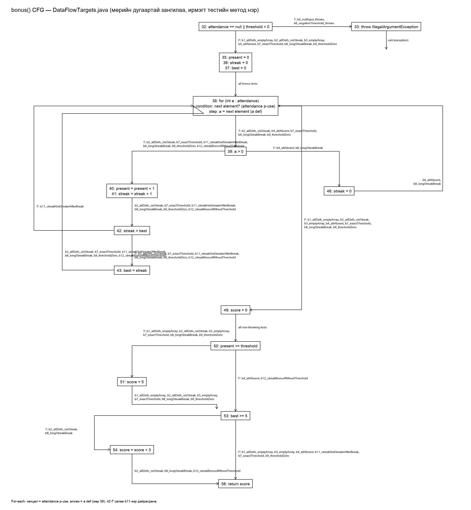

# Лаборатори №10 — Өгөгдлийн урсгалын тест: Definition-Use хосууд

- **Нэр:** Н.Ням-Од
- **Оюутны код:** B222270805
- **Хичээл:** F.CSA313 — Программ хангамжийн чанарын баталгаа ба тест (2026)

## Орчны гаралт

`java -version`:

```
java version "23.0.2" 2025-01-21
Java(TM) SE Runtime Environment (build 23.0.2+7-58)
Java HotSpot(TM) 64-Bit Server VM (build 23.0.2+7-58, mixed mode, sharing)
```

`mvn -version`:

```
Apache Maven 3.9.12 (848fbb4bf2d427b72bdb2471c22fced7ebd9a7a1)
Maven home: /opt/homebrew/Cellar/maven/3.9.12/libexec
Java version: 25.0.2, vendor: Homebrew, runtime: /opt/homebrew/Cellar/openjdk/25.0.2/libexec/openjdk.jdk/Contents/Home
Default locale: en_MN, platform encoding: UTF-8
OS name: "mac os x", version: "26.5", arch: "aarch64", family: "mac"
```

Тайлбар: `java` тушаал нь JDK 23-ыг, Maven нь өөрийн JAVA_HOME-оор Homebrew-ийн OpenJDK 25-ыг ашиглаж байна; pom.xml-д `release=17` тул бай код 17-оор compile хийгдэнэ. macOS (arm64) орчинд ажиллуулсан; зааврын Ubuntu-тай ижил тушаалууд.

## A хэсэг: gcd — бүрэн DU хүснэгт

Файлын мөрийн дугаар (`DataFlowTargets.java`): 13 — `gcd(int x, int y)` параметрийн def; 15 — `while (y != 0)`; 16 — `tmp = x % y`; 17 — `x = y`; 18 — `y = tmp`; 20 — `return x`. Лекцийн слайдын 1–8 дугаарлалтыг файлын мөр рүү хөрвүүлэв (1→13, 3→15, 4→16, 5→17, 6→18, 8→20).

Def/Use цэгүүд:

| Хувьсагч | Def мөрүүд | c-use мөрүүд | p-use мөрүүд |
|---|---|---|---|
| x | 13, 17 | 16, 20 | — |
| y | 13, 18 | 16, 17 | 15 (T/F) |
| tmp | 16 | 18 | — |

Бүх DU хос (def-clear замтай):

| # | Хувьсагч | Def мөр | Use мөр | c-use/p-use | Def-clear зам | Тестийн ID | Хамрагдсан эсэх |
|---|---|---|---|---|---|---|---|
| 1 | x | 13 | 16 | c-use | 13→15(T)→16 | G3 | Тийм |
| 2 | x | 13 | 20 | c-use | 13→15(F)→20 | G1 | Тийм |
| 3 | x | 17 | 16 | c-use | 17→18→15(T)→16 | G3 | Тийм |
| 4 | x | 17 | 20 | c-use | 17→18→15(F)→20 | G2, G3 | Тийм |
| 5 | y | 13 | 15 (F) | p-use | 13→15(F) | G1 | Тийм |
| 6 | y | 13 | 15 (T) | p-use | 13→15(T) | G2, G3 | Тийм |
| 7 | y | 13 | 16 | c-use | 13→15(T)→16 | G2, G3 | Тийм |
| 8 | y | 13 | 17 | c-use | 13→15(T)→16→17 | G2, G3 | Тийм |
| 9 | y | 18 | 15 (T) | p-use | 18→15(T) | G3 | Тийм |
| 10 | y | 18 | 15 (F) | p-use | 18→15(F) | G2, G3 | Тийм |
| 11 | y | 18 | 16 | c-use | 18→15(T)→16 | G3 | Тийм |
| 12 | y | 18 | 17 | c-use | 18→15(T)→16→17 | G3 | Тийм |
| 13 | tmp | 16 | 18 | c-use | 16→17→18 | G2, G3 | Тийм |

Kill тэмдэглэл: мөр 17 нь x-ийн 13-р мөрийн def-ийг, мөр 18 нь y-ийн 13/18-р мөрийн def-ийг, мөр 16 нь tmp-ийн өмнөх def-ийг тус тус ална. Иймд 13→(17-г дайрсан)→16 гэх мэт замууд def-clear БИШ, DU хос болохгүй (ж: x:13→16 хоёр дахь давталтад биш, зөвхөн эхний давталтад хүчинтэй).

Лекцийн хүснэгтэд дутуу үлдсэн хосууд: (x,17→16), (x,17→20), (y,18→15 T/F), (y,18→16), (y,18→17), (tmp,16→18) — давталтын буцах ирмэгээр үүсдэг эдгээр хосыг нөхөв.

### Тестүүдийн тайлбар (GcdTest.java, all-DU-pairs)

- **G1 `g1_zeroY_coversEntryDefs` — gcd(7,0):** давталт 0 удаа. (x,13→20) хосыг ГАНЦААРАА хамардаг: y=0 тул 15(F) салаагаар шууд 20-р мөрөнд x-ийн анхны def хүрнэ; мөн (y,13→15 F).
- **G2 `g2_zeroX_coversFirstIterationDefs` — gcd(0,5):** давталт 1 удаа. x=0 тул эхний давталтад tmp=0, x=5, y=0 болж (x,17→20), (y,18→15 F), (tmp,16→18), (y,13→16/17) хосуудыг хамарна.
- **G3 `g3_twoIterations_coversLoopBackPairs` — gcd(12,8):** давталт 2 удаа (12%8=4 → (8,4); 8%4=0 → (4,0)). Давталт шаарддаг хосууд: (y,15→15 T) буюу 18-р мөрийн def буцаж 15-д T болох, (x,17→16), (y,18→16), (y,18→17) — эдгээр нь зөвхөн 2+ давталтад def-clear замаар хүрнэ.

3 тест = 13/13 DU хос, all-DU-pairs хангагдсан.
## B хэсэг: bonus — бүрэн анализ

### B1 — CFG



Зангилаа бүр файлын мөрийн дугаартай, ирмэг бүр түүнийг дайрдаг тестийн бодит метод нэртэй. Graphviz эх: `docs/cfg-bonus.dot` (зураг нь PIL-ээр рендерлэсэн). For-each давталт (мөр 38): нөхцөл = attendance-д дараагийн элемент байгаа эсэх (attendance-ийн p-use, T/F), алхам = дараагийн элементийг a-д оноох (a-ийн def). Улаан ирмэг (42 F) = биелэшгүй салаа, тест байхгүй.

### B2 — Def/Use жагсаалт (мөр бүрээр)

| Мөр | Код | Def | c-use | p-use |
|---|---|---|---|---|
| 31 | `bonus(int[] attendance, int threshold)` | attendance, threshold (параметр) | — | — |
| 32 | `if (attendance == null \|\| threshold < 0)` | — | — | attendance (null эсэх), threshold (<0 эсэх) |
| 33 | `throw ...` | — | — | — |
| 35 | `int present = 0;` | present | — | — |
| 36 | `int streak = 0;` | streak | — | — |
| 37 | `int best = 0;` | best | — | — |
| 38 | `for (int a : attendance)` | a (алхам бүр) | — | attendance (дараагийн элемент байгаа эсэх) |
| 39 | `if (a > 0)` | — | — | a |
| 40 | `present = present + 1;` | present | present | — |
| 41 | `streak = streak + 1;` | streak | streak | — |
| 42 | `if (streak > best)` | — | — | streak, best |
| 43 | `best = streak;` | best | streak | — |
| 46 | `streak = 0;` | streak | — | — |
| 49 | `int score = 0;` | score | — | — |
| 50 | `if (present >= threshold)` | — | — | present, threshold |
| 51 | `score = 5;` | score | — | — |
| 53 | `if (best >= 5)` | — | — | best |
| 54 | `score = score + 3;` | score | score | — |
| 56 | `return score;` | — | score | — |

### B3 — DU хүснэгт (def-clear замтай бүх хос)

| # | Хувьсагч | Def мөр | Use мөр | c/p | Def-clear зам | Тестийн ID | Хамрагдсан |
|---|---|---|---|---|---|---|---|
| 1 | attendance | 31 | 32 (T) | p | 31→32(T) | b5 | Тийм |
| 2 | attendance | 31 | 32 (F) | p | 31→32(F) | b1, b2, b6 | Тийм |
| 3 | attendance | 31 | 38 (T) | p | 31→32(F)→35..37→38(T) | b2 | Тийм |
| 4 | attendance | 31 | 38 (F) | p | 31→32(F)→35..37→38(F) | b1 | Тийм |
| 5 | threshold | 31 | 32 (T) | p | 31→32(F\|\|T) | b6 | Тийм |
| 6 | threshold | 31 | 32 (F) | p | 31→32(F\|\|F) | b1, b2 | Тийм |
| 7 | threshold | 31 | 50 (T) | p | 31→32(F)→…→50(T) | b1, b2 | Тийм |
| 8 | threshold | 31 | 50 (F) | p | 31→32(F)→…→50(F) | b3, b4 | Тийм |
| 9 | present | 35 | 50 (T) | p | 35→38(F)→49→50(T) | b1 | Тийм |
| 10 | present | 35 | 50 (F) | p | 35→38(F)→49→50(F) | b3, b4 | Тийм |
| 11 | present | 40 | 40 | c | 40→41→42(T)→43→38(T)→39(T)→40 | b2 | Тийм |
| 12 | present | 40 | 50 (T) | p | 40→…→38(F)→49→50(T) | b2 | Тийм |
| 13 | present | 40 | 50 (F) | p | 40→…→38(F)→49→50(F) | b4 | Тийм |
| 14 | streak | 36 | 41 | c | 36→37→38(T)→39(T)→41 | b2 | Тийм |
| 15 | streak | 36 | 42 (T) | p | 36→…→41→42(T) | b2 | Тийм |
| 16 | streak | 41 | 41 | c | 41→42(T)→43→38(T)→39(T)→41 | b2 | Тийм |
| 17 | streak | 41 | 42 (T) | p | 41→42(T) | b2 | Тийм |
| 18 | streak | 41 | 43 | c | 41→42(T)→43 | b2 | Тийм |
| 19 | streak | 46 | 41 | c | 46→38(T)→39(T)→41 | b8 | Тийм |
| 20 | streak | 46 | 42 (T) | p | 46→38(T)→39(T)→41→42(T) | b8 | Тийм |
| 21 | best | 37 | 42 (T) | p | 37→38(T)→39(T)→40→41→42(T) | b2 | Тийм |
| 22 | best | 37 | 53 (F) | p | 37→38(F)→49→50→53(F) | b1 | Тийм |
| 23 | best | 37 | 53 (T) | p | — | — | Биелэшгүй (доор) |
| 24 | best | 43 | 42 (T) | p | 43→38(T)→39(T)→40→41→42(T) | b2 | Тийм |
| 25 | best | 43 | 53 (T) | p | 43→38(F)→49→50→53(T) | b2 | Тийм |
| 26 | best | 43 | 53 (F) | p | 43→38(F)→49→50→53(F) | b7, b9 | Тийм |
| 27 | a | 38 | 39 (T) | p | 38(T)→39(T) | b2 | Тийм |
| 28 | a | 38 | 39 (F) | p | 38(T)→39(F) | b4, b8 | Тийм |
| 29 | score | 49 | 56 | c | 49→50(F)→53(F)→56 | b3, b4 | Тийм |
| 30 | score | 51 | 54 | c | 51→53(T)→54 | b2 | Тийм |
| 31 | score | 51 | 56 | c | 51→53(F)→56 | b1, b7, b9 | Тийм |
| 32 | score | 54 | 56 | c | 54→56 | b2 | Тийм |

**Kill тэмдэглэгээ:** мөр 46 (`streak = 0`) нь streak-ийн 36 ба 41-р мөрийн def-үүдийг АЛДАГ. Иймд 36→41/42, 41→41/42/43 хосууд 46-г дайрсан замд def-clear БИШ — DU хос болохгүй (ж: тасалдалтын дараах давталтад хуучин streak-ийн def хүрэхгүй). Мөн 40 нь present-ийн 35/40 def-ийг, 41 нь streak-ийн 36/41/46 def-ийг, 43 нь best-ийн 37/43 def-ийг, 51/54 нь score-ийн 49/51 def-ийг тус тус ална.

**Def-clear замгүй (DU хос биш) хослолууд:** (streak,36→42 T) ба (streak,41→42 T/43) — 46-г дайрсан замд kill-ээр тасарна; (best,43→42 F) — 42 F салаа өөрөө биелэшгүй; (streak,36/41/46→42 F) — мөн биелэшгүй салаа.

**Биелэшгүй хос/салааны үндэслэл:**
- (best,37→53 T): best=0 хэвээр үлдэхийн тулд давталт бүр 39 F (a≤0) байх ёстой → present=0 → 50 T болохын тулд threshold=0 → score=5 боловч best=0 тул 53 T боломжгүй; давталтгүй бол present=0, threshold=0 мөн best=0.
- (best,37→42 F) ба 42 F салаа: 42-т хүрэх бүрд streak≥1 ба best нь өмнөх streak-үүдийн max тул best≥streak; streak>best байж чадахгүй.
- (streak,36→42 F), (streak,41→42 F), (streak,46→42 F): дээрхтэй ижил, 42 F биелэшгүй.

### B4 — Тестүүд, шат 1: ALL-DEFS (хамгийн цөөн = 2)

All-defs хангахад **2 тест** хангалттай, түүнээс цөөн болохгүй:

- **b1 `b1_allDefs_emptyArray` — bonus([],0)=5:** (present=0 >= threshold=0 тул 51 score=5; best=0 тул 53 F) давталтгүй тул 35, 36, 37, 49, 51-ийн def-үүдийг 50/53/56-д шууд хүргэнэ; attendance-ийн 38 F p-use.
- **b2 `b2_allDefs_sixStreak` — bonus([1,1,1,1,1,1],5)=8:** 38(a), 40, 41, 43, 51, 54-ийн def-үүдийг use-д хүргэнэ; 35/36/37-ийн def-үүд эхний итерацид, 49→51→54→56.

Яагаад 1 тест болохгүй вэ: score-ийн 51 ба 54 def-үүд нэг гүйцэтгэлд хоёулаа use-д хүрэхийн тулд present≥threshold ба best≥5 зэрэг биелэх ёстой → дор хаяж 5 ирсэн өдөр хэрэгтэй → attendance хоосон БИШ → 38 F ирмэг (attendance-ийн p-use F) хэзээ ч дайрагдахгүй. Хоосон массивтай тест заавал тусдаа хэрэгтэй тул 2-оос цөөн боломжгүй.

Шат 1-ийн гаралт: `results/mvn-verify-alldefs.txt`, `results/jacoco-alldefs.csv` (GcdTest 3 + BonusTest 4 = Tests run: 7; boundary b5/b6 нь 32 T салааг нөхнө).

### B5 — JaCoCo ба branch vs DU ажиглалт

`results/jacoco-alldefs.csv` (all-defs шат): INSTRUCTION 76/81, **BRANCH_COVERED=13, BRANCH_MISSED=3** (13/16), **LINE_COVERED=22, LINE_MISSED=2** (мөр 7 далд constructor + мөр 46 `streak = 0` — all-defs шатанд 39 F салаа дайрагдаагүй).

All-defs хангагдсан ч branch 100% биш байж болно: all-defs нь def бүрийг ЯМАР НЭГ use-д хүргэхийг шаарддаг болохоос салаа бүрийг шаарддаггүй — 39 F, 50 F, 42 F салаанууд def-үүдийн use-д хүрэхэд заавал биш.

`results/jacoco-final.csv` (эцсийн, C-гийн дараа): BRANCH_MISSED=0 (16/16), LINE_MISSED=1 (зөвхөн мөр 7).

Branch 100% болсон ч DU хүснэгтэд хамрагдаагүй хос үлдэж болно — лекцийн гол баталгаа. Жишээ: all-defs дээр зөвхөн (streak,46→41) хосыг хамруулахын тулд [0,1] гэх мэт тест branch-ийн 39 F/46-г нөхөж 16/16 болгож чадна, гэхдээ (streak,46→42 T) хос (reset хийсний дараа 2+ дараалсан ирц) хамрагдахгүй үлдэнэ — branch хамралт DU хосыг ХЭМЖДЭГГҮЙ.

### B4 — Тестүүд, шат 2: ALL-DU-PAIRS

Шат 1-ийн 4 тест дээр нэмэх нь:

- **b3 `b3_emptyArray_belowThreshold` — bonus([],7)=0:** (present,35→50 F), (threshold,31→50 F), (score,49→56) — хоосон массив + threshold>0.
- **b4 `b4_allAbsent` — bonus([0,0,0],1)=0:** (a,38→39 F), 39 F салаа, streak def 46; (present,40→50 F)-ийг мөн b8 хаана.
- **b7 `b7_exactThreshold_shortStreak` — bonus([1,1,1],3)=5:** яг threshold; (best,43→53 F), (score,51→56), (present,40→50 T).
- **b8 `b8_longStreakBreak` — bonus([1×6,0,1×6],6)=8:** урт цуваа дунд нь тасрах; kill (46)-ийн дараах (streak,46→41), (streak,46→42 T) хосуудыг ГАНЦААРАА хамарна; (present,40→50 F).
- **b9 `b9_thresholdZero` — bonus([1],0)=5:** threshold=0 захын нөхцөл.

Нийт BonusTest 9 + GcdTest 3 = **Tests run: 12**, бүх DU хос (32/32 биелэгдэх хос) хамрагдсан; эцсийн гаралт C-гийн дараа `results/mvn-verify-final.txt`, `results/jacoco-final.csv`-д (BRANCH_MISSED=0, 16/16).
